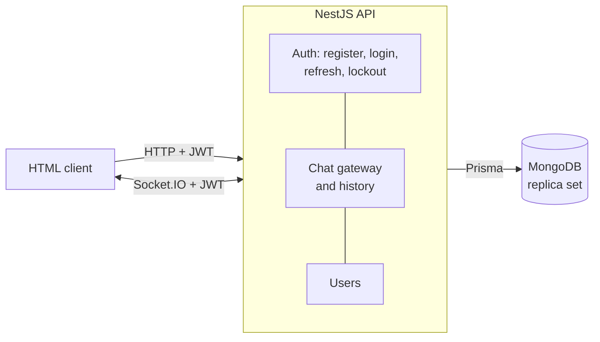

# Chatty

A real-time one-to-one chat API: NestJS with Socket.IO, Prisma on MongoDB, JWT access and refresh tokens, and account lockout, plus a small HTML and JavaScript client.

## Overview

Users register and log in over HTTP and get a short-lived access token and a longer-lived refresh token. The client opens a Socket.IO connection with the access token, joins the user's own room, and sends messages over the socket. The server stores each message in MongoDB and delivers it to the receiver's room. Past conversations come from an HTTP endpoint.

## Features

- **Accounts:** registration and login with bcrypt-hashed passwords; five wrong passwords lock the account for 15 minutes.
- **Tokens:** 15-minute access tokens and 7-day refresh tokens, each typed so one cannot stand in for the other.
- **Real-time messaging:** Socket.IO with token authentication; the sender is always the socket's own user, and each user receives only their own room's messages.
- **History:** `GET /chat/messages?userId=` returns the conversation with another user, oldest first.
- **Protection:** validation that rejects unknown fields, a rate limit of 10 HTTP requests a minute per client, and only id and username exposed for other users.
- **Client:** plain HTML pages for register, login and chat (`client/`).

## Architecture



## Tech stack

NestJS 11, TypeScript, Socket.IO, Prisma 6 with MongoDB, Passport JWT, bcrypt, class-validator, `@nestjs/throttler`, Jest, ESLint and Prettier. Client: HTML, CSS and JavaScript, with the Socket.IO client from its CDN.

## Getting started

You need Node.js 20 or later (`.nvmrc` pins 22) and MongoDB running as a replica set, which Prisma requires. A MongoDB Atlas cluster works; locally, a single-node replica set in Docker does:

```bash
docker run -d --name chatty-mongo -p 27017:27017 mongo:7 --replSet rs0 --bind_ip_all
docker exec chatty-mongo mongosh --eval 'rs.initiate({_id:"rs0",members:[{_id:0,host:"localhost:27017"}]})'
```

Then:

```bash
git clone https://github.com/a-3isa/chatty
cd chatty
npm ci
cp .env.example .env                  # then fill in the values
npx prisma generate
npx prisma db push                    # creates the indexes; MongoDB has no Prisma migrations
npm run start:dev                     # http://localhost:3000
```

| Variable | Required | Purpose |
|---|---|---|
| `DATABASE_URL` | yes | MongoDB connection string for a replica set |
| `JWT_SECRET` | yes | Signs every token; the app will not start without it |
| `PORT` | no (3000) | HTTP and Socket.IO port |
| `NODE_ENV`, `ALLOWED_ORIGINS` | in production | With `NODE_ENV=production`, the comma-separated origins allowed to call the HTTP API |

**Client.** The pages call `http://localhost:3000`, and in development the API accepts requests from `http://localhost:3001`. Serve the folder there and open the login page in two browsers:

```bash
npx http-server client -p 3001        # then open http://localhost:3001/register.html
```

For a production build: `npm run build`, then `npm run start:prod`.

## API

HTTP routes need `Authorization: Bearer <access token>`, except register and login.

| Route | Purpose |
|---|---|
| `POST /auth/register` `{ username, password }` | Create an account; returns access and refresh tokens |
| `POST /auth/login` `{ username, password }` | Returns `{ userId, accessToken, refreshToken }` |
| `POST /auth/refresh` `{ refreshToken }` | Returns a new access token |
| `POST /auth/forgot-password` `{ username }` | Creates a reset token (logged on the server; no email is sent) |
| `POST /auth/reset-password?token=` `{ password }` | Sets a new password with a reset token |
| `POST /auth/unlock-account` `{ username }` | Clears the lockout of the caller's own account |
| `GET /users` | Every user's id and username |
| `GET /chat/messages?userId=` | The conversation with that user |

Socket.IO (connect with `auth: { token: <access token> }`):

| Event | Payload | Effect |
|---|---|---|
| `join` | your own user id | Join your room to receive messages |
| `sendMessage` | `{ receiverId, content }` | Store the message and emit `receiveMessage` to the receiver's room |

## Project structure

```
src/
  auth/        register, login, refresh, reset, lockout, JWT strategy and guard
  chat/        Socket.IO gateway, message history
  users/       user list
  middleware/  request sanitisation (not enabled)
prisma/        schema (User, Message)
client/        register, login and chat pages
```

## Testing and checks

```bash
npm test               # unit tests (Jest)
npm run lint           # ESLint, no fixes applied
npm run format:check   # Prettier
npm run build
```

The unit tests cover token types, the socket rules, account unlocking and the public user fields. `test/app.e2e-spec.ts` is still the NestJS starter test (it expects `GET /` to return "Hello World!" without a token), so `npm run test:e2e` does not pass. CI runs lint, format check, build and unit tests on every pull request and on pushes to `master`.

## Security notes

See [SECURITY.md](SECURITY.md) for what the code does today, what is not active yet, and how to report a vulnerability.

## Known issues and roadmap

These are bugs in the current code, recorded here rather than hidden:

- **Refresh and password reset need an access token.** The global JWT guard only exempts register and login, so `/auth/refresh` fails once the access token has expired, and `forgot-password` and `reset-password` work only for a signed-in user.
- `forgot-password` says a link was emailed, but it only logs it on the server, and it reveals whether a username exists.
- Helmet, the sanitisation middleware and the CSRF guard are in the code but not enabled; the Socket.IO server accepts any origin.
- The client keeps tokens in `localStorage`.
- Planned: real end-to-end tests, and Prisma 7.

## License and author

UNLICENSED: the source is public for portfolio review, and no licence is granted to reuse it. Built by Ahmed Ibrahim Hussien ([a-3isa](https://github.com/a-3isa)).
